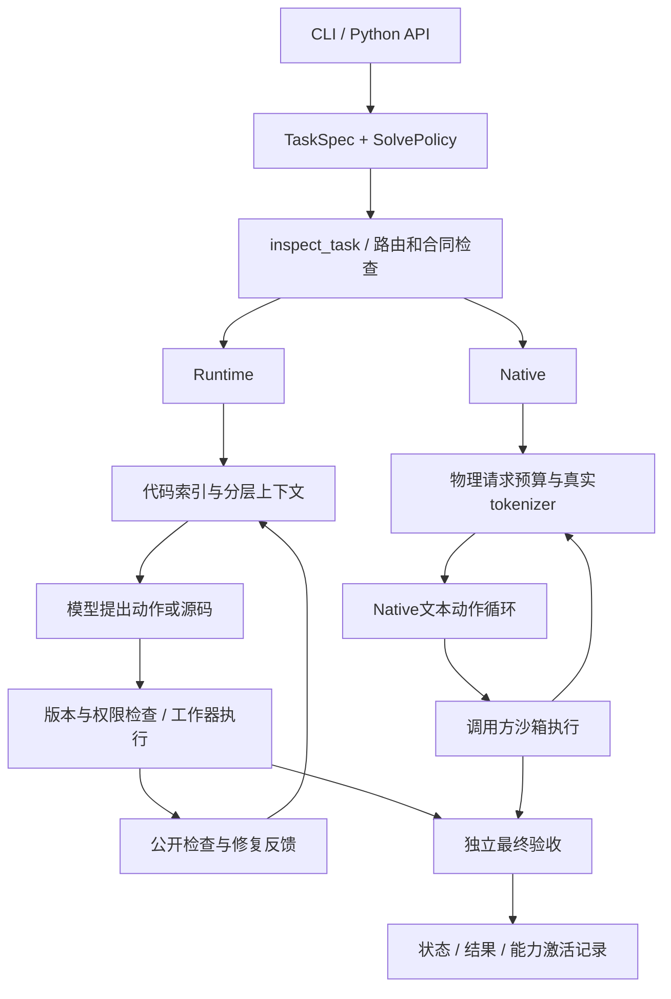

# InfiniCoder 项目代码说明

本文对应 **0.8.0a11** 的实际代码。用于理解入口、功能归属、关键调用链和维护位置。公开API以 `from infinicoder import ...` 为主；高级能力可从 `infinicoder.advanced` 获取。目录调整没有新增模型能力成绩，也没有把所有可选机制默认启用。

## 从哪里开始读

建议按以下顺序，而不是从顶层文件名逐个阅读：

1. `app/task_solver.py`：用户任务如何变成后端和模块选择。
2. `app/config.py` 与 `routing/profiles.py`：普通入口的默认配置与领域判断。
3. `runtime/engine.py`：Runtime的实际动作循环、工作器、状态和验收。
4. `analysis/code_context.py` → `memory/repository_memory.py` → `runtime/work_packet.py`：代码如何被解析、存储并送入模型。
5. `runtime/native_run.py` → `models/native_transport.py` → `execution/native_sandbox.py`：Native的模型请求、预算和隔离执行。
6. `verification/acceptance.py`、`verification/runtime_checks.py`：成功怎样由外部检查确认。

## 功能目录

顶层的 `__init__.py` 保留延迟公共导出，`__main__.py` 支持 `python -m infinicoder`，`advanced.py` 提供高级导入，`_resources.py` 统一定位包内资源与源码身份文件。业务实现进入功能包，不用一层兼容转发文件重新铺满根目录。

| 目录 | 实现模块数（不含包初始化） | 职责 |
| --- | ---: | --- |
| `app/` | 9 | CLI、Python任务入口、配置和任务装配。选择执行后端，不另造智能体循环。 |
| `models/` | 7 | InfiniLM兼容HTTP、真实tokenizer与上下文预算、物理请求账本和交付策略。 |
| `runtime/` | 31 | Runtime与Native主循环、动作协议、实现工作器、失败反馈与局部修复。 |
| `runtime/extensions/` | 3 | 条件能力管线与分阶段修复；需要配置或任务选择才能启用。 |
| `routing/` | 8 | 领域分类、模块标签与合同、能力卡和开发流程模板。 |
| `analysis/` | 17 | 代码索引、作用域与use-def、调用候选、符号限定及张量数据流。 |
| `languages/` | 2 | Python外围解析与C/C++/CUDA编译数据库及Clang适配。 |
| `memory/` | 38 | 分层仓库记忆、读取覆盖、任务历史、检查点、接口与状态证据。 |
| `memory/source/` | 34 | 源位置、源码范围、问题式读取、按预算交付与版本失效。 |
| `planning/` | 28 | 任务合同、模块和依赖计划、阶段执行、问题分解、复查与重规划。 |
| `execution/` | 10 | 文件范围、进程资源限制、CPU沙箱、任务私有文件和作用域核验。 |
| `verification/` | 30 | 公开检查、故障复现、差分观察、训练状态检查及最终验收。 |
| `search/` | 6 | 候选试验、完整检查点、分支恢复、公开反例筛选；适用于通用任务。 |
| `optimization/` | 5 | 性能目标、外部测量、分析器和有条件的优化实现器。 |
| `domains/operator/` | 25 | 逐元素、卷积、矩阵乘、归约和归一化的受限候选及调度策略。 |
| `domains/sysdev/` | 1 | 生命周期的可观察检查，供系统设计诊断调用。 |
| `collaboration/` | 6 | 显式多角色策略、共享预算、证据和执行命名空间；默认不自动启动。 |
| `tools/` | 13 | 代码工作台、只读源码工具、shell桥接、工具发现和notebook修改。 |
| `session/` | 2 | 会话状态、事件、锁、版本与需求修订。 |

`capabilities/` 保存能力义务JSON，`knowledge/` 保存指导卡，`workflows/` 保存领域流程。它们是产品数据，不是实验结果。`native_defaults.json` 是Native文本协议默认提示。`languages/` 保留独立语言适配器，Python与Clang入口在分析层被调用。

`runtime/extensions/` 是显式增强策略，`memory/source/` 专门放源码视图和读取工作集。算子算法位于 `domains/operator/`；通用候选分支在 `search/`，通用测量在 `optimization/`，因此不会把所有优化都误归为算子功能。

## 两条执行路径

### Runtime：日常编程与持久会话

`create_runtime` 将常用配置、模型客户端和会话目录交给 `Runtime`。`Runtime.execute` 校验任务和已保存配置、建立索引、选择工作器和上下文，再处理模型动作。动作必须通过路径、权限、源码版本和当前阶段检查。公开诊断可以用于下一轮修复；最终验收由任务绑定的检查器执行。

文件/函数工作器是同一Runtime内的实现模式，通常让模型提交实现内容，再由控制器应用。它们不表示自动启动多个独立智能体。暂停、澄清、恢复和需求修订主要属于这条路径。`SessionStore` 保存状态与事件，恢复继续消费原预算，而不是重新获得完整预算。

### Native：Linux隔离命令执行

`create_cpu_request` 装配CoreRequest、真实tokenizer、公开操作与独立验收。`NativeRunCore` 在共享截止内启动 `NativeAgent`。模型通过 `InfiniLMTextModel` 调用本地受控中继，中继再连接指定服务，并把每次实际请求登记到物理账本。一个辅助规划调用同样计入预算。

文本响应先通过格式和完成状态检查，再将动作交给 `NativeSandboxExecution`。后者使用调用方授权的命名空间argv和有界进程执行器；任务私有临时目录、写入范围及子进程超时仍由控制器管理。候选自报“通过”不能结束独立验收。Native当前是单次任务执行，不继承Runtime的完整恢复协议。

### 模型层与InfiniLM的关系

InfiniCoder是智能体，InfiniLM提供独立的模型服务。Runtime的 `CompatibleClient` 和Native的 `InfiniLMTextModel` 直接访问兼容聊天HTTP接口，不需要LiteLLM或外部mini-SWE安装包。服务URL、实际模型ID、密钥和tokenizer由调用方提供。Native使用文本动作协议，不要求开启服务端工具解析器。

普通HTTP请求不自动重试结果未知的派发；交付策略确认请求尚未发出时才允许有限重试。价格未知时记录为未定价，token用量与物理请求记录另行保留。支持某个HTTP协议不代表推理引擎已支持所有模型权重。

## 代码分析、记忆和上下文分别做什么

| 层次 | 关键实现 | 保存或处理的内容 | 不应混淆的边界 |
| --- | --- | --- | --- |
| 代码事实 | `analysis/code_context.py`、`languages/` | 文件、符号、作用域、静态调用和use-def候选、源位置和哈希 | 复杂动态分派、别名或编译信息不足时保留未知 |
| 仓库记忆 | `memory/repository_memory.py`、`long_memory.py` | 仓库→模块→符号的分层组织和图展开 | 不等于所有代码已进入模型输入 |
| 源码工作集 | `memory/source/` | 当前问题相关的原文、版本、读取范围、片段引用和预算 | 模块路由记录不等于模型读过函数体 |
| 任务经历 | `memory/task_memory.py`、`action_*`、`task_state_checkpoint.py` | 动作、实际反馈、假设、证据和当前状态 | 未验证备忘不能升级为源码事实 |
| 跨任务经验 | `ExperienceBank` | 调用方显式提供并约束适用范围的经验 | 默认没有自动全局经验累积；评测需隔离 |
| 物理上下文 | `runtime/work_packet.py`、`models/budget.py` | 当前合同、源码、失败证据、输出预留和实际计数 | 未提供真实tokenizer时部分Runtime路径采用估计 |

编辑、删除或重命名后，旧事实须按源码身份失效。静态关系是检索线索，不是执行证明；实际行为由运行、公开诊断与最终验收建立。多个记忆适配器经常共享同一数据层，因此“文件数量多”不代表存在同样数量的独立记忆系统，也不意味着可以任意叠加。

## 哪些能力实际启用

| 能力 | 普通入口状态 | 显式配置与限制 |
| --- | --- | --- |
| 基础索引与分层代码记忆 | Runtime默认建立索引，`code_memory=True` | 读取仍受范围与上下文预算限制；Clang需编译信息 |
| 领域路由 | `profile="auto"` | general/operator/framework是规则选择，不是学习得到的MoE |
| 算子/框架流程 | `development_workflows=True`且命中领域 | 指导卡不是正确性或性能证据 |
| 文件/函数实现工作器 | `automatic_workers=True`，条件符合时选择 | 单一Runtime的实现模式，不是多智能体 |
| 受限算子候选 | `domain_compiler=True`且模式与合同匹配 | 不是任意算子编译器；不匹配时走模型流程 |
| 基础计划与阶段检查 | 由任务范围、已有里程碑和工作器决定 | 不能据此宣称所有复杂任务均自主架构规划 |
| Native源码记忆 | cpu-auto按可读源码和输入规模选择 | 严格检查上下文所有者，某些投影机制互斥 |
| Native产物计划 | cpu-auto的多文件复杂任务且有写入权限、预算 | 当前还要求至少15次调用、300秒；其他路径可显式配置 |
| Native任务历史 | `SolvePolicy(context="task")`等显式入口 | 与部分源码规划模式互斥，不自动叠加 |
| 性能搜索/融合/候选分支 | 标准solve不自动全部启用 | 需外部测量、公开选择器、候选合同与共享预算 |
| 多角色协作 | 普通入口默认不启用 | `collaboration/`显式装配角色、预算与命名空间 |
| 经验库 | 默认未配置 | `ExperienceBank`由调用方提供 |

`inspect_task` 返回选择原因；`capabilities.json` 记录选择与实际激活。selected、activated、delivered、最终通过是不同状态。静态调用图表明代码可到达，不说明它在默认任务中会执行，更不能证明成功率收益。

## 算子与系统框架任务怎样落到代码

算子任务由路由确定领域，流程要求明确数学语义、shape、dtype、独立stride、精度和硬件条件。`domains/operator/` 只对支持的公开源码模式或明确合同提供种子、调度及候选。`search/` 管理试验和版本化检查点，`optimization/` 依据外部正确性及测量保留或回退，`verification/` 接收真实程序产生的结果。候选打印的PASSED或耗时不作为独立证据。

系统框架任务使用同一个智能体执行链，加上framework流程中的训练数值、状态恢复、资源所有权、并发和生命周期关注点。`planning/` 描述模块及接口，`analysis/`、`memory/` 提供代码关系；`checkpoint_procedure` 和公开transition适配器可在明确合同下比较训练/恢复过程。它们是可装配工具，不会自动生成分布式集群或保证任意框架均构建成功。

## 文件是否都有用

本轮把下面四项旧实现从发布源码移出，并在本地归档。判据是同时核对内部导入、公共导出、命令/子进程引用和维护测试，不是只看文件名：

| 原位置 | 判断与处理 |
| --- | --- |
| `domains/operator/numerical.py` | 孤立数值检查原型，未接入现有执行或验收；移出 |
| 旧 `domains/operator/seeds.py` | 孤立重复SeedCatalog，未被调用；移出。当前同一路径承载从原顶层迁入、仍被调用的正式种子目录实现 |
| `domains/sysdev/state_checks.py` | 孤立状态检查原型，未被现有流程使用；移出，保留实际使用的lifecycle_probe |
| `public_reproduction_docker.py` | 无入口、导出、内部调用和维护测试的旧Docker复现适配；移出 |

反例是 `verification/public_check_client.py` 与 `public_replay_worker.py`：它们被复制或挂载到沙箱中独立执行，不能因常规导入图里没有调用者而删除。工作台worker/client也有类似职责。

保留的代码包括日常核心、任务条件触发的功能、显式高级扩展和必要的沙箱程序。它们有用途或可追踪入口，但并非每项都已证明带来模型能力提升。是否进一步合并模块，应看共享状态、稳定接口和实际使用频率；本次没有为了减少文件数把互斥适配器强行合为一个大文件。

## 如何扩展与维护

- 增加模型服务行为：改 `models/`；保持普通调用无隐式重试，保留usage和派发状态。
- 增加语言或代码视图：改 `analysis/`、`languages/`、`memory/source/`；带上源位置、哈希和未知关系。
- 增加任务类型：先修改 `routing/` 的标签、前置条件、冲突与预算，再接具体实现。
- 增加计划策略：改 `planning/`；保留原始任务约束，阶段通过后仍执行最终验收。
- 增加编程工具：改 `tools/`；读写与执行权限必须来自调用方合同。
- 增加领域候选：改 `domains/operator/`；声明适用条件，接到 `search/`、`optimization/` 和外部检查。
- 增加协作角色：改 `collaboration/`；所有角色共享原始预算，父级保留最终验收。
- 修改暂停/恢复：改 `session/` 和Runtime接点；不能通过恢复重置已消费预算。

包内源码哈希和资源统一通过 `_resources.py` 定位。不要重新使用“某个模块的父目录一定等于包根目录”的假设。复制到沙箱的独立程序必须继续只携带其显式依赖，并验证子进程入口。

### 这次整理的兼容边界

`from infinicoder import Runtime, TaskSpec, SolvePolicy, solve, ...`、公共高级属性和命令名称保留。内部直接导入路径改为功能包，如 `infinicoder.models.model_client`、`infinicoder.analysis.code_context`、`infinicoder.runtime.engine`；不保留数百个顶层转发文件。包源码哈希、部分轨迹中的模块限定名和源码资源路径会变化；已有会话仍需遵守版本/配置身份校验，不能假定从旧版本无条件恢复。

### 仍需要继续收敛的部分

目录归类没有消除所有耦合。`runtime/engine.py`仍是最大的调度器，后续适合按“会话控制、上下文组装、动作分派、验证策略”逐步拆分。源码工作集和Native适配器还有多个不同合同，未来应在稳定接口下减少重复实现。高级路由属于规则和标签组合，尚无证据说明它等同于学习式专家系统。以上是架构维护方向，不是本轮已完成的能力提升。

## 逐模块索引

下表覆盖业务实现，不重复列包初始化文件。用途来自当前源码与入口；主要符号仅列公开顶层类型/函数，详细签名请跳转源码。所有路径相对 `src/infinicoder/`。

### app：用户入口

| 文件 | 用途 | 主要符号 |
| --- | --- | --- |
| [adaptive.py](../../src/infinicoder/app/adaptive.py) | 运行模块标签路由后的显式配置；不是普通auto领域分类的替代入口。 | `run_routed`、`main` |
| [cli.py](../../src/infinicoder/app/cli.py) | 常用命令行入口，将inspect/solve与普通Runtime参数分派给对应实现。 | `main` |
| [config.py](../../src/infinicoder/app/config.py) | 常用RuntimeConfig与create_runtime，避免调用方手工填写全部内部参数。 | `RuntimeConfig`、`create_runtime`、`session_configuration_identity`、`validate_session_configuration` |
| [development_api.py](../../src/infinicoder/app/development_api.py) | 将领域流程、源码能力、实现权限与外部检查绑定为开发请求。 | `configure_development_request`、`create_development_request` |
| [native_api.py](../../src/infinicoder/app/native_api.py) | Linux CPU执行请求装配：沙箱、tokenizer、项目环境、公开检查与独立验收。 | `run_native`、`create_cpu_request` |
| [native_cli.py](../../src/infinicoder/app/native_cli.py) | Native高级命令行，显式选择内存、工具、规划及执行合同。 | `main` |
| [session_cli.py](../../src/infinicoder/app/session_cli.py) | Read session status/events/diffs and request cooperative pause/cancel. | `main` |
| [solve_cli.py](../../src/infinicoder/app/solve_cli.py) | 把统一任务CLI参数转换成TaskSpec、SolvePolicy、模型及环境合同。 | `main` |
| [task_solver.py](../../src/infinicoder/app/task_solver.py) | inspect_task/solve统一选择和调用两个后端，记录选择与实际激活。 | `SolvePolicy`、`inspect_task`、`solve` |

### models：模型与预算

| 文件 | 用途 | 主要符号 |
| --- | --- | --- |
| [budget.py](../../src/infinicoder/models/budget.py) | ModelProfile、TokenEstimator、上下文计数及输出预留。 | `heuristic_tokens`、`TokenEstimator`、`ModelProfile`、`BudgetExceeded`、`ContextAssembler` |
| [http_transport.py](../../src/infinicoder/models/http_transport.py) | 认证HTTP请求禁用自动重定向，限制凭据与源码的发送目标。 | `NoRedirect`、`open_request` |
| [infinilm_client.py](../../src/infinicoder/models/infinilm_client.py) | InfiniLMTextModel，直接HTTP文本动作请求，保留原始usage并拒绝不完整动作。 | `default_config`、`InfiniLMModelConfig`、`Completion`、`InfiniLMTextModel` |
| [model_client.py](../../src/infinicoder/models/model_client.py) | CompatibleClient与ModelConfig，供Runtime直接调用指定模型服务。 | `ModelResponse`、`ProviderError`、`ModelConfig`、`validate_model_config`、`CompatibleClient` |
| [native_delivery_policy.py](../../src/infinicoder/models/native_delivery_policy.py) | 逻辑请求与物理派发状态；仅确认未派发时可有限重试。 | `NativeDeliveryExhausted`、`ConfirmedNotDispatched`、`DeliveryPolicy`、`QueryDelivery` |
| [native_transport.py](../../src/infinicoder/models/native_transport.py) | 本地中继绑定真实tokenizer、物理调用限额、任务截止和用量账本。 | `LocalChatCounter`、`NativeCompatibleTransport` |
| [scheduled_client.py](../../src/infinicoder/models/scheduled_client.py) | 显式多生成配置的客户端包装，控制推理/生成设置及调用核算。 | `GenerationProfile`、`ScheduledClient`、`fast_reason_fast` |

### runtime：执行主循环

| 文件 | 用途 | 主要符号 |
| --- | --- | --- |
| [agent_execution.py](../../src/infinicoder/runtime/agent_execution.py) | CoreRequest/CoreBudget/CoreOutcome合同与Runtime/Native后端分派。 | `UnsupportedCore`、`CoreBudget`、`AuxiliaryCallBudget`、`FinalAcceptance`、`ModelBinding`、`NativeTaskBinding` 等 |
| [command_evidence.py](../../src/infinicoder/runtime/command_evidence.py) | Optional session-local public command observations;never acceptance proofs. | `identity`、`aliases`、`locations`、`observe`、`view`、`pack` |
| [command_worker.py](../../src/infinicoder/runtime/command_worker.py) | 用受限命令实现代码变更的工作器。 | `shell`、`system_prompt`、`history_pairs`、`action`、`json_system_prompt`、`json_schema` 等 |
| [compatible_tools.py](../../src/infinicoder/runtime/compatible_tools.py) | Opt-in complete XML compatibility without changing the shell workflow prompt. | `identity`、`decode` |
| [engine.py](../../src/infinicoder/runtime/engine.py) | Runtime核心调度：装配任务、上下文、权限、工作器、修复、会话和最终验收。 | `CommandArgvFormatError`、`command_argv`、`Runtime`、`run`、`main` |
| [feedback.py](../../src/infinicoder/runtime/feedback.py) | 把公开观察转成修复上下文，绑定原动作和运行结果。 | `acceptance_packet`、`failed_observation`、`failure_packet`、`observation_packet`、`command_runtime_observation`、`command_runtime_text` 等 |
| [format_repair.py](../../src/infinicoder/runtime/format_repair.py) | Optional model view of runtime-proven pre-dispatch format rejections. | `identity`、`project`、`recent_view` |
| [implementation_proposal.py](../../src/infinicoder/runtime/implementation_proposal.py) | One optional, source-bound body proposal. No task answers or semantic oracle. | `dump`、`delivery`、`ProposalPreparation`、`ImplementationProposal` |
| [implementation_window.py](../../src/infinicoder/runtime/implementation_window.py) | One bounded implementation protocol after repeated current source coverage. | `digest`、`identity`、`requirement`、`eligible`、`close`、`observe` 等 |
| [json_proposals.py](../../src/infinicoder/runtime/json_proposals.py) | One audited JSON delimiter repair;never rewrites model strings or source. | `load` |
| [native_agent.py](../../src/infinicoder/runtime/native_agent.py) | 文本动作循环：查询、格式错误反馈、执行、退出与轨迹保存。 | `AgentConfig`、`NativeAgent` |
| [native_environment.py](../../src/infinicoder/runtime/native_environment.py) | 沙箱环境的配置和完成检测基类，不提供宿主命令执行器。 | `NativeEnvironmentConfig`、`NativeEnvironment` |
| [native_implementation_proposal.py](../../src/infinicoder/runtime/native_implementation_proposal.py) | One proposal then one original Native core run, on the original shared budget relay. | `run_implementation_proposal` |
| [native_plain.py](../../src/infinicoder/runtime/native_plain.py) | 最小Native上下文观察器，记录实际输入而不补充代码知识。 | `NativePlainObserver` |
| [native_protocol.py](../../src/infinicoder/runtime/native_protocol.py) | 动作解析、观察格式、提交与预算退出消息、递归状态合并。 | `InterruptAgentFlow`、`Submitted`、`LimitsExceeded`、`TimeExceeded`、`UserInterruption`、`FormatError` 等 |
| [native_run.py](../../src/infinicoder/runtime/native_run.py) | Native普通任务的预算边界、上下文接点、循环启动及最终验收。 | `CoreDeadline`、`NativeRunCore` |
| [problem_decision.py](../../src/infinicoder/runtime/problem_decision.py) | Bounded source-supported next-action decisions,inside the original budget. | `schema`、`control`、`available`、`offer`、`context`、`check_lease` 等 |
| [problem_worker.py](../../src/infinicoder/runtime/problem_worker.py) | 复杂问题实现模式，结合诊断与当前工作流。 | `finish`、`lease`、`select`、`decline`、`dispatch`、`applied` 等 |
| [problem_workflow.py](../../src/infinicoder/runtime/problem_workflow.py) | One task question,versioned source views and a bounded discriminating probe. | `encoded`、`digest`、`contract`、`identity`、`event`、`recent_records` 等 |
| [proposal_delivery.py](../../src/infinicoder/runtime/proposal_delivery.py) | Lossless delivery shaping using the current module,never executing code. | `strict_json`、`normalize_body` |
| [proposal_history.py](../../src/infinicoder/runtime/proposal_history.py) | Project a real prior controller event into the initial task context slot. | `historical_event`、`project_history` |
| [protocol.py](../../src/infinicoder/runtime/protocol.py) | 模型动作与Runtime工具的结构化协议和校验。 | `final_payload`、`ActionProtocolError`、`validate_dispatch`、`action_schema` |
| [qualified_worker.py](../../src/infinicoder/runtime/qualified_worker.py) | 以限定符号为目标的实现模式。 | `select` |
| [recovery.py](../../src/infinicoder/runtime/recovery.py) | Evidence-based recovery across changing proposals, without task dispatch. | `RecoveryPolicy` |
| [shell_control.py](../../src/infinicoder/runtime/shell_control.py) | Conservative shell *syntax* classification for read-only diagnostics. | `classify_shell_control` |
| [shell_loop.py](../../src/infinicoder/runtime/shell_loop.py) | Runtime文本动作链、当前工具、观察、编辑和验证衔接。 | `identity`、`all_tools`、`tools`、`system_prompt`、`decode`、`append` 等 |
| [stalled_feedback.py](../../src/infinicoder/runtime/stalled_feedback.py) | 在重复失败或无进展时提供有证据的下一步反馈。 | `identity`、`lease`、`note_check`、`schedule`、`dispatch`、`context` |
| [task_packet.py](../../src/infinicoder/runtime/task_packet.py) | 保留完整任务合同的task-first上下文格式。 | `identity`、`digest`、`render` |
| [text_frontend.py](../../src/infinicoder/runtime/text_frontend.py) | 在Runtime循环内提供文本动作格式，执行权限仍归Runtime。 | `dependency`、`NoExecutionEnvironment`、`QueryModel`、`Frontend` |
| [work_packet.py](../../src/infinicoder/runtime/work_packet.py) | 构建Runtime的任务合同、源码、反馈和当前阶段上下文。 | `WorkPacketBuilder` |
| [worker.py](../../src/infinicoder/runtime/worker.py) | 文件、函数和领域实现工作器；不等同于独立多智能体。 | `SourceFormatError`、`requires_initial_clarification`、`merge_native_fragment`、`SourceInterfaceMismatch`、`preserve_bindings`、`complete_module_imports` 等 |

### runtime/extensions：可选执行策略

| 文件 | 用途 | 主要符号 |
| --- | --- | --- |
| [native_capability_pipeline.py](../../src/infinicoder/runtime/extensions/native_capability_pipeline.py) | Conditional capabilities sharing one Native core,source journal and query owner. | `CapabilityPipelinePolicy`、`capability_selection`、`NativeRouteObserver`、`NativeCapabilityPipeline`、`write_capability_metadata` |
| [native_repair.py](../../src/infinicoder/runtime/extensions/native_repair.py) | One evidence-bound native repair handoff; never another model query loop. | `RepairHandoff`、`RepairStagnation`、`RepairProgress`、`RepairSeed`、`NativeRepairContinuation` |
| [native_repair_run.py](../../src/infinicoder/runtime/extensions/native_repair_run.py) | Run two bounded repair phases with shared transport and independent final acceptance. | `run_with_repair` |

### routing：任务路由

| 文件 | 用途 | 主要符号 |
| --- | --- | --- |
| [capability.py](../../src/infinicoder/routing/capability.py) | 加载并组合能力义务与检查要求。 | `CapabilityRegistry` |
| [capability_router.py](../../src/infinicoder/routing/capability_router.py) | 带输入输出、成本、冲突和依赖的模块注册表及标签路由。 | `Module`、`registry`、`identity`、`repository_inventory`、`classify`、`decide` 等 |
| [development_workflow.py](../../src/infinicoder/routing/development_workflow.py) | 按领域与当前检查状态生成开发步骤和关注点。 | `identity`、`workflow_packet` |
| [execution_profiles.py](../../src/infinicoder/routing/execution_profiles.py) | 把路由模块组合映射为受支持的执行配置。 | `choose` |
| [knowledge.py](../../src/infinicoder/routing/knowledge.py) | 加载指导卡；知识卡本身不构成已验证实现。 | `teaching_card` |
| [profiles.py](../../src/infinicoder/routing/profiles.py) | 从任务语义和有限仓库信息选择general/operator/framework。 | `Route`、`repository_route_facts`、`route_task` |
| [routing_contracts.py](../../src/infinicoder/routing/routing_contracts.py) | 各模块可接受的输入和预期输出合同。 | `applicability`、`compose` |
| [task_tags.py](../../src/infinicoder/routing/task_tags.py) | 将任务特征转换为可追踪的路由标签。 | `extract` |

### analysis：代码分析

| 文件 | 用途 | 主要符号 |
| --- | --- | --- |
| [clang_resources.py](../../src/infinicoder/analysis/clang_resources.py) | Caller-selected parser resources,never a repository command or installer. | `arguments`、`resolve` |
| [code_context.py](../../src/infinicoder/analysis/code_context.py) | SQLite代码索引、搜索、符号与关系管理、更新与原生分析展开。 | `digest`、`dataflow_identity`、`words`、`python_facts`、`heuristic_facts`、`CodeIndex` 等 |
| [compact_question_flow.py](../../src/infinicoder/analysis/compact_question_flow.py) | Small source-linked static relations;group alternatives,never choose a branch. | `relation`、`dependency_versions`、`first_pair` |
| [dataflow.py](../../src/infinicoder/analysis/dataflow.py) | Python AST静态use-def和关系候选。 | `python_use_def` |
| [function_body.py](../../src/infinicoder/analysis/function_body.py) | 提取函数签名和实现范围，支持受限函数实现。 | `identity`、`read_function_body`、`edit_function_body` |
| [heap_flow.py](../../src/infinicoder/analysis/heap_flow.py) | Python对象与堆关系的保守静态候选。 | `identity`、`may_updates` |
| [local_edit.py](../../src/infinicoder/analysis/local_edit.py) | 局部源码变更与语法约束。 | `scope_for`、`select`、`invalid`、`advance`、`view` |
| [native_analysis.py](../../src/infinicoder/analysis/native_analysis.py) | 按剩余时间在隔离子进程中进行C/C++语义扩展。 | `install_parent_guard`、`IndexBudgetExceeded`、`policy_identity`、`expand`、`main` |
| [native_effects.py](../../src/infinicoder/analysis/native_effects.py) | 从原生语法提取可观察的读写与生命周期候选。 | `identity`、`function_facts`、`current_native_inputs`、`current_native_facts`、`links` |
| [native_macros.py](../../src/infinicoder/analysis/native_macros.py) | 宏定义与字面依赖视图，不模拟完整预处理器。 | `definitions`、`collect` |
| [qualified_symbols.py](../../src/infinicoder/analysis/qualified_symbols.py) | 限定符号、作用域和静态所有者候选；不把动态分派当确定关系。 | `module_names`、`resolve`、`anchors` |
| [source_question_syntax.py](../../src/infinicoder/analysis/source_question_syntax.py) | 问题式读取返回的静态语法事实。 | 模块常量 / 内部辅助 |
| [symbol_tools.py](../../src/infinicoder/analysis/symbol_tools.py) | 按符号读取和修改的受限操作，校验源码版本。 | `identity`、`split_symbol`、`callable_ranges`、`read_symbol`、`edit_symbol`、`read_function_body` 等 |
| [syntax_edits.py](../../src/infinicoder/analysis/syntax_edits.py) | 语法编辑实现身份及与调用方权限的接口。 | `identity`、`preflight` |
| [task_compiler.py](../../src/infinicoder/analysis/task_compiler.py) | 任务与公开源码模式匹配，构建受限领域候选。 | `CompileError`、`WorkUnit`、`WorkGraph`、`compile_task`、`classify_failure` |
| [tensor_dataflow.py](../../src/infinicoder/analysis/tensor_dataflow.py) | 绑定源位置的张量值、布局与资源使用候选。 | `identity`、`digest`、`declarations`、`Flow`、`analyze`、`pack` 等 |
| [tensor_io.py](../../src/infinicoder/analysis/tensor_io.py) | 静态张量输入输出视图，实际数据和运行验证需外部证据。 | `analyze` |

### languages：语言解析器

| 文件 | 用途 | 主要符号 |
| --- | --- | --- |
| [clang_adapter.py](../../src/infinicoder/languages/clang_adapter.py) | Optional libclang AST adapter. Compilation commands are parsed, never run. | `header_fingerprint`、`header_inputs`、`semantic_arguments`、`clang_facts` |
| [native_adapter.py](../../src/infinicoder/languages/native_adapter.py) | minimal native (C/C++/CUDA) adapter. | `BuildProfile`、`native_facts`、`native_context` |

### memory：代码与任务记忆

| 文件 | 用途 | 主要符号 |
| --- | --- | --- |
| [action_effect_memory.py](../../src/infinicoder/memory/action_effect_memory.py) | 动作效果的版本化记录；旧执行结果不能证明当前源码正确。 | `source_state`、`relation`、`ActionEffectRecord`、`make_effect_record`、`EffectSequence`、`VersionLabels` 等 |
| [action_source_memory.py](../../src/infinicoder/memory/action_source_memory.py) | 将动作、源码版本和实际反馈关联，避免把意图当作执行事实。 | `SourceSnapshot`、`read_snapshot`、`SourceRevisionRecord`、`observe_revision`、`FocusRecord`、`choose_focus` 等 |
| [continuous_conversation.py](../../src/infinicoder/memory/continuous_conversation.py) | 保留当前动作链和完整约束的连续上下文组织。 | `encoded`、`digest`、`identity`、`validate`、`preflight`、`implementation_targets` 等 |
| [evidence_route.py](../../src/infinicoder/memory/evidence_route.py) | Pure evidence-operation selection; no source, shell, model or check runs. | `choose_evidence_operation` |
| [execution_evidence_selection.py](../../src/infinicoder/memory/execution_evidence_selection.py) | Select original whole history blocks by distinct observed evidence. | `select_history` |
| [flow_memory.py](../../src/infinicoder/memory/flow_memory.py) | 按数据流链路组织源码片段与不确定关系。 | `identity`、`slice_function`、`bounded_slice`、`pack` |
| [inspection_ledger.py](../../src/infinicoder/memory/inspection_ledger.py) | 记录带源码版本的实际读取范围和覆盖。 | `identity`、`InspectionLedger` |
| [inspection_memory.py](../../src/infinicoder/memory/inspection_memory.py) | 保存当前读取的可复用事实与不足。 | `bounded_read`、`bounded_workpack`、`remember_read`、`current_coverage`、`retain_current_reads` |
| [inspection_navigation.py](../../src/infinicoder/memory/inspection_navigation.py) | 根据问题路由下一次源码读取。 | `identity`、`action`、`locations`、`continuation`、`missing_path`、`recovery_identity` 等 |
| [inspection_recovery.py](../../src/infinicoder/memory/inspection_recovery.py) | 在已有读取证据不足时生成明确的补充读取方向。 | `identity`、`contract`、`validated_read`、`observe`、`pending`、`session_context` |
| [interface_memory.py](../../src/infinicoder/memory/interface_memory.py) | 按接口组织源码关系和调用约束。 | `identity`、`schemas`、`bounded_view`、`action`、`pack` |
| [long_memory.py](../../src/infinicoder/memory/long_memory.py) | HierarchicalMemory与ExperienceBank；源码事实和经验需分开。 | `HierarchicalMemory`、`ExperienceBank` |
| [native_action_effect_memory.py](../../src/infinicoder/memory/native_action_effect_memory.py) | 把动作效果记录接到Native原始查询边界。 | `EffectBudgetExpired`、`NativeActionEffectMemory` |
| [native_action_reassessment.py](../../src/infinicoder/memory/native_action_reassessment.py) | One evidence-based decision after a verified actionless length failure. | `last_attempt`、`verified_length_failure`、`NativeActionReassessment` |
| [native_episode_memory.py](../../src/infinicoder/memory/native_episode_memory.py) | Native单任务经历上下文，预算与原始调用方共享。 | `NativeEpisodeMemory` |
| [native_evidence_route.py](../../src/infinicoder/memory/native_evidence_route.py) | Conditional evidence execution in one original native agent loop. | `PostEditPublicBudget`、`NativeEvidenceRoute` |
| [native_memory.py](../../src/infinicoder/memory/native_memory.py) | Native代码记忆和物理输入容量检查。 | `MemoryCapacityError`、`NativeRepositoryMemory` |
| [native_observed_interface_map.py](../../src/infinicoder/memory/native_observed_interface_map.py) | Default-off,transient representation of source already delivered to the Native core. | `MapMaintenanceExpired`、`NativeObservedInterfaceMap` |
| [native_phase_history.py](../../src/infinicoder/memory/native_phase_history.py) | 分阶段任务历史和共享上下文绑定。 | `PhaseHistoryBinding`、`NativePhaseHistoryContext` |
| [native_revision_task_checkpoint.py](../../src/infinicoder/memory/native_revision_task_checkpoint.py) | 将检查点与当前源码修订绑定。 | `NativeRevisionTaskCheckpoint`、`cpu_checkpoint_reader` |
| [native_single_history.py](../../src/infinicoder/memory/native_single_history.py) | 普通Native单次执行的历史适配，避免多个上下文所有者。 | `NativeSinglePhaseHistory` |
| [native_task_evidence_context.py](../../src/infinicoder/memory/native_task_evidence_context.py) | One source plan plus a versioned working set under actual capacity pressure. | `NativeTaskEvidenceContext` |
| [native_task_state_consolidation.py](../../src/infinicoder/memory/native_task_state_consolidation.py) | 以明确状态检查点保留任务约束和证据。 | `NativeTaskStateConsolidation` |
| [observed_interface_map.py](../../src/infinicoder/memory/observed_interface_map.py) | 从实际读取过的源码构造接口关系视图。 | `dump`、`digest`、`ObservedSource`、`InterfaceMap`、`definitions`、`blocks` 等 |
| [pressure_context.py](../../src/infinicoder/memory/pressure_context.py) | Whole observed source regions compete with old history only under pressure. | `identity`、`configure_pressure_evidence`、`JointSnapshot`、`snapshot`、`assemble` |
| [question_memory.py](../../src/infinicoder/memory/question_memory.py) | 按当前问题选择值、状态、资源或接口视图。 | `identity`、`select`、`pack` |
| [repair_memory.py](../../src/infinicoder/memory/repair_memory.py) | Session-local independent repair observations,kept separate from code facts. | `identity`、`signature`、`observe`、`view` |
| [repair_submission.py](../../src/infinicoder/memory/repair_submission.py) | One existing patch submission,leased to an observed public failure. | `digest`、`identity`、`capture`、`select`、`validate`、`claim` 等 |
| [repository_memory.py](../../src/infinicoder/memory/repository_memory.py) | 从索引构建持久模块摘要与按预算展开的图视图。 | `identity`、`RepositoryMemory` |
| [revision_feedback.py](../../src/infinicoder/memory/revision_feedback.py) | Optional independent feedback after an observed shell revision transition. | `identity`、`revision`、`after_command` |
| [revision_memory.py](../../src/infinicoder/memory/revision_memory.py) | Versioned model hypotheses across representation-only design rejection. | `identity`、`fingerprint`、`capture`、`current`、`view` |
| [state_memory.py](../../src/infinicoder/memory/state_memory.py) | 按可观察状态和状态转移组织代码事实。 | `close`、`clauses`、`collect` |
| [task_checkpoint_sources.py](../../src/infinicoder/memory/task_checkpoint_sources.py) | 构建、校验当前检查点中的源码集合。 | `SourceStateBundle`、`validate_checkpoint_sources`、`build_checkpoint_sources`、`refresh_checkpoint_sources` |
| [task_evidence_context.py](../../src/infinicoder/memory/task_evidence_context.py) | Versioned source/hypothesis/observation state and whole-block projection. | `sha`、`ranges`、`TaskEvidenceContext` |
| [task_history_archive.py](../../src/infinicoder/memory/task_history_archive.py) | 导出任务私有只读历史，沙箱读取程序不会执行历史命令。 | `dump`、`TaskHistoryArchive` |
| [task_memory.py](../../src/infinicoder/memory/task_memory.py) | 按问题、值、状态、资源和接口组织任务相关源码事实。 | `identity`、`python_function_facts`、`bounded_summary`、`TaskMemory` |
| [task_state_checkpoint.py](../../src/infinicoder/memory/task_state_checkpoint.py) | 任务状态、证据索引与未验证备忘的分离存储。 | `dump`、`digest`、`EvidenceIndex`、`TaskStateCheckpoint`、`UnverifiedTaskMemo`、`prepare_checkpoint` 等 |
| [task_working_memory.py](../../src/infinicoder/memory/task_working_memory.py) | 以当前任务的动作与反馈维持有预算的工作状态。 | `TaskWorkingMemory` |

### memory/source：源码视图与工作集

| 文件 | 用途 | 主要符号 |
| --- | --- | --- |
| [anchored_source_workset.py](../../src/infinicoder/memory/source/anchored_source_workset.py) | Common public-root repair and independently optional dependency exposure. | `build_anchored_workset` |
| [evidence_source.py](../../src/infinicoder/memory/source/evidence_source.py) | Explicit read-only source capability; no code tools or namespace requirement. | `literal_source_read`、`ReadOnlyTaskSources` |
| [native_anchored_source.py](../../src/infinicoder/memory/source/native_anchored_source.py) | Task-anchored Native context;ordinary Native core loop and shell remain unchanged. | `NativeAnchoredSourceWorkset` |
| [native_evidence_context.py](../../src/infinicoder/memory/source/native_evidence_context.py) | 把有实际来源的任务历史选择与可选shell工具绑定分开。 | `EvidenceSelectionMixin`、`NativeEvidenceSourceWorkset` |
| [native_evidence_workset.py](../../src/infinicoder/memory/source/native_evidence_workset.py) | 在原shell工具上装配按证据来源选择的任务记忆。 | `NativeEvidenceWorkset` |
| [native_observation_reselection.py](../../src/infinicoder/memory/source/native_observation_reselection.py) | Opt-in bounded diagnosis in one original DefaultAgent.run. | `known_revision`、`ObservationReselection`、`NativeObservationReselection` |
| [native_reversible_working_set.py](../../src/infinicoder/memory/source/native_reversible_working_set.py) | 可展开和回看的物理源码工作集，不依赖模型摘要替代原文。 | `SourceAttachment`、`NativeWorkingSet` |
| [native_source_question.py](../../src/infinicoder/memory/source/native_source_question.py) | 将问题式读取工具绑定到Native当前动作租约。 | `NativeSourceQuestionActions` |
| [native_source_workset.py](../../src/infinicoder/memory/source/native_source_workset.py) | Current source workset on the real native Native core; no memory command interface. | `NativeSourceWorkset` |
| [native_working_set.py](../../src/infinicoder/memory/source/native_working_set.py) | Versioned literal source evidence shared with the ordinary action controller. | `pack` |
| [observed_edits.py](../../src/infinicoder/memory/source/observed_edits.py) | Optional editing against a runtime-recorded read revision. | `identity`、`record`、`prepare`、`guidance` |
| [observed_source_reads.py](../../src/infinicoder/memory/source/observed_source_reads.py) | 只把实际可见原文登记为已读取。 | `sha`、`literal_read`、`lf_lines`、`SourceSlice`、`ReadToken`、`ReadObservationWorkset` |
| [source_archive.py](../../src/infinicoder/memory/source/source_archive.py) | 版本化源码片段存储、引用和读取。 | `identity`、`encoded`、`digest`、`event_key`、`register`、`load` 等 |
| [source_boundaries.py](../../src/infinicoder/memory/source/source_boundaries.py) | 区分签名、文档、实现等真实语法范围。 | `identity`、`augment_read`、`finish_visible_read` |
| [source_dependency_view.py](../../src/infinicoder/memory/source/source_dependency_view.py) | 沿调用与数据依赖构建源码视图，并保留未知边。 | `CurrentSources`、`location`、`expand` |
| [source_focus.py](../../src/infinicoder/memory/source/source_focus.py) | 基于当前Python源码提出暂定实现焦点。 | `identity`、`select`、`invalid`、`context`、`action` |
| [source_handoff.py](../../src/infinicoder/memory/source/source_handoff.py) | 将当前源码工作集交付给实现阶段，并保留身份约束。 | `turn_identity`、`protocol`、`project_turn`、`project_history`、`record_turn`、`render_turn` 等 |
| [source_observation.py](../../src/infinicoder/memory/source/source_observation.py) | Literal views of actual historical reads;no source facts or authority minted. | `identity`、`observed`、`fence`、`full`、`bounded` |
| [source_output.py](../../src/infinicoder/memory/source/source_output.py) | 输出源码视图与明确的预算/未知状态。 | `SourceOutputClosed`、`SourceOutputHalt`、`digest`、`identity`、`stop`、`capture` 等 |
| [source_packet_budget.py](../../src/infinicoder/memory/source/source_packet_budget.py) | 用实际计数限制源码包，预算不足时明确拒绝。 | `bounded_prefix` |
| [source_question.py](../../src/infinicoder/memory/source/source_question.py) | 把一个明确的问题映射为有界源码事实。 | `NeedContextRequest`、`SourceAnswer`、`answer_context_request` |
| [source_question_action.py](../../src/infinicoder/memory/source/source_question_action.py) | 从问题选择相关静态事实和源位置，不提供写权限。 | `SourceAnswerCapacityError`、`answer_source_question` |
| [source_question_command.py](../../src/infinicoder/memory/source/source_question_command.py) | 沙箱中的问题式源码读取命令协议。 | `question_file`、`run_source_question_command` |
| [source_questions.py](../../src/infinicoder/memory/source/source_questions.py) | Literal source views routed by explicit references;no source/command execution. | `request`、`lookup` |
| [source_read_session.py](../../src/infinicoder/memory/source/source_read_session.py) | 在单次读取会话内管理候选范围、预算和读取覆盖。 | `SourceReadSession` |
| [source_scope.py](../../src/infinicoder/memory/source/source_scope.py) | 源码可读范围及路径归属。 | `declarations`、`choose`、`packet`、`restore` |
| [source_sync.py](../../src/infinicoder/memory/source/source_sync.py) | 编辑后更新源码视图、任务范围和关联身份。 | `identity`、`observe`、`project_observation`、`project_pairs`、`project_record`、`pack` |
| [source_table.py](../../src/infinicoder/memory/source/source_table.py) | Lossless factoring of visible source provenance;no summarization or reads. | `register`、`project`、`restore`、`render` |
| [source_units.py](../../src/infinicoder/memory/source/source_units.py) | 按实现单元暴露源码、范围、哈希及必要约束。 | `ordinary_action`、`identity`、`charge_proposal`、`digest`、`interfaces`、`binding` 等 |
| [source_workset.py](../../src/infinicoder/memory/source/source_workset.py) | 按任务与读取证据维护当前源码工作集。 | `public_target_present`、`build_source_workset` |
| [task_source_evidence.py](../../src/infinicoder/memory/source/task_source_evidence.py) | Bounded, non-executing source evidence for initial workflow selection. | `collect` |
| [task_source_roots.py](../../src/infinicoder/memory/source/task_source_roots.py) | Resolve reading roots from public task text, without inventing edit scope. | `relative_public_path`、`resolve_public_roots` |
| [working_set.py](../../src/infinicoder/memory/source/working_set.py) | Put versioned implementation excerpts before optional memory metadata. | `pack` |
| [workset_output.py](../../src/infinicoder/memory/source/workset_output.py) | A bounded readonly output wrapper; never a shell or a subprocess executor. | `WorksetOutputRequest`、`parse_workset_output` |

### planning：规划与诊断

| 文件 | 用途 | 主要符号 |
| --- | --- | --- |
| [behavior_plan.py](../../src/infinicoder/planning/behavior_plan.py) | 行为层计划合同，区分目标、假设和需要验证的动作。 | `digest`、`requirement_text`、`BehaviorPlanPolicy`、`route`、`read_script`、`parse_script` 等 |
| [contract_review.py](../../src/infinicoder/planning/contract_review.py) | 复查明确需求和当前实现范围的合同。 | `dump`、`digest`、`ContractReviewPolicy`、`lightweight`、`changed_source`、`parse_review` |
| [design_delta.py](../../src/infinicoder/planning/design_delta.py) | Explicit reference-only amendment of a fully displayed model hypothesis. | `identity`、`digest`、`available`、`offer`、`materialize` |
| [design_investigation.py](../../src/infinicoder/planning/design_investigation.py) | 围绕公开源码和失败证据调查设计假设。 | `identity`、`pending`、`begin`、`tools`、`schema`、`decode` 等 |
| [design_probes.py](../../src/infinicoder/planning/design_probes.py) | 将设计假设转换成受限可观察检查。 | `identity`、`schemas`、`run`、`current`、`context` |
| [diagnostic_flow.py](../../src/infinicoder/planning/diagnostic_flow.py) | 将错误、源码与重规划问题关联为诊断流程。 | `identity`、`failure`、`key`、`request`、`pending`、`completed` 等 |
| [diagnostic_namespaces.py](../../src/infinicoder/planning/diagnostic_namespaces.py) | Caller-declared compiler locations in a version-bound check snapshot. | `normalize`、`from_cli`、`validate_checks`、`identity`、`relative_path`、`observe` |
| [diagnostics.py](../../src/infinicoder/planning/diagnostics.py) | Bounded compiler diagnostics and stable failure identities. | `compiler_diagnostics`、`stable_failure` |
| [domain_contract.py](../../src/infinicoder/planning/domain_contract.py) | 领域任务中的接口和不变量合同。 | `identity`、`key`、`pending`、`begin`、`schema`、`context` 等 |
| [example_diagnosis.py](../../src/infinicoder/planning/example_diagnosis.py) | Bounded evaluation of caller examples against a pure arithmetic source view. | `identity`、`number`、`expression`、`functions`、`analyze` |
| [failure_routing.py](../../src/infinicoder/planning/failure_routing.py) | Late,version-bound diagnosis guidance from independent verification evidence. | `identity`、`view` |
| [model_plan_escape.py](../../src/infinicoder/planning/model_plan_escape.py) | A model's implementation plan is revocable; the caller contract is not. | `digest`、`identity`、`bind`、`active`、`eligible`、`scope_refusal` 等 |
| [native_artifact_architecture.py](../../src/infinicoder/planning/native_artifact_architecture.py) | 校验模型提出的产物、依赖、接口和检查计划。 | `artifact_graph`、`NativeArtifactArchitecture` |
| [native_behavior_plan.py](../../src/infinicoder/planning/native_behavior_plan.py) | One ordinary Native core workflow:public scenario→edit→same scenario→actual feedback. | `dump`、`NativeBehaviorPlan` |
| [native_contract_review.py](../../src/infinicoder/planning/native_contract_review.py) | Once: real edit→independent review→public observation→original Native core revision. | `ReviewPreparationExpired`、`NativeContractReview` |
| [native_design.py](../../src/infinicoder/planning/native_design.py) | Bounded optional design grammar;syntax never certifies a semantic design. | `schema` |
| [native_plan.py](../../src/infinicoder/planning/native_plan.py) | A source-bound inspect/design/implement/check workflow for native methods. | `identity`、`select`、`invalid`、`context`、`action` |
| [native_prepare.py](../../src/infinicoder/planning/native_prepare.py) | Prerequisite provider for optional native analysis;never a success judge. | `inputs`、`candidate`、`perform` |
| [native_source_planning.py](../../src/infinicoder/planning/native_source_planning.py) | 基于真实可读源码准备Native实现计划。 | `PlanningDeadline`、`planning_alarm`、`NativeSourcePlanning`、`workspace_source_reader` |
| [permission_planning.py](../../src/infinicoder/planning/permission_planning.py) | Separate writable permissions from mandatory architecture-planning evidence. | `identity`、`entry`、`guidance` |
| [phase_replanning.py](../../src/infinicoder/planning/phase_replanning.py) | 在失败证据和预算允许时进行阶段重规划。 | `identity`、`PhaseScopeRejection`、`prepare`、`request`、`view` |
| [plan_execution.py](../../src/infinicoder/planning/plan_execution.py) | 阶段依赖执行、当前阶段状态和中间验收。 | `identity`、`fingerprints`、`failure_paths`、`record_write`、`preflight`、`context` 等 |
| [planning.py](../../src/infinicoder/planning/planning.py) | 基于任务范围和导入依赖的阶段计划，不保证自主完成架构设计。 | `bounded_planning_context`、`plan_schema`、`proposed_plan`、`python_file_order`、`stage_python_task` |
| [replan_protocol.py](../../src/infinicoder/planning/replan_protocol.py) | Keep proven unexecuted response failures out of architecture replanning. | `identity`、`refusal`、`blocked` |
| [source_plan.py](../../src/infinicoder/planning/source_plan.py) | Compile source-grounded plans without turning inspected dependencies into edits. | `SourceEvidenceRequired`、`record_planning_rejection`、`planning_feedback_view`、`record_planning_read`、`identity`、`grounded_plan_schema` 等 |
| [state_contract.py](../../src/infinicoder/planning/state_contract.py) | 状态与状态转换的明确合同。 | `effect_schema`、`bind`、`check` |
| [task_contract.py](../../src/infinicoder/planning/task_contract.py) | TaskSpec、Check与任务合同校验。 | `validate_task_spec`、`Check`、`TaskSpec` |
| [task_source_plan.py](../../src/infinicoder/planning/task_source_plan.py) | Question-directed source views; model suggestions never become code facts. | `dump`、`SourcePlanInput`、`PlanDraft`、`parse_draft`、`WorkspaceSourcePlanReader`、`MappedWorkspaceSourcePlanReader` 等 |

### execution：执行与权限

| 文件 | 用途 | 主要符号 |
| --- | --- | --- |
| [candidate_sandbox.py](../../src/infinicoder/execution/candidate_sandbox.py) | Parent-owned, CPU-only execution for bounded candidate snapshots. | `SnapshotRunner` |
| [checkpoint_native_parser.py](../../src/infinicoder/execution/checkpoint_native_parser.py) | Read-only native definition parser inside the caller's existing namespace. | `definitions`、`main` |
| [docker_task_history.py](../../src/infinicoder/execution/docker_task_history.py) | Caller-predeclared read-only task history for an owned Docker environment. | `DockerTaskHistoryMount` |
| [execution.py](../../src/infinicoder/execution/execution.py) | ExecutionProfile、输出预算和执行限额。 | `ExecutionProfile`、`OutputBudget` |
| [native_cpu.py](../../src/infinicoder/execution/native_cpu.py) | CPU沙箱与项目Python环境的装配。 | `CpuExecution`、`ScriptAcceptance` |
| [native_sandbox.py](../../src/infinicoder/execution/native_sandbox.py) | 通过调用方命名空间构造器执行命令，记录执行并管理任务私有临时目录。 | `NativeSandboxExecution` |
| [native_scope.py](../../src/infinicoder/execution/native_scope.py) | Optional Clang-backed native function packets, with exact body-only merges. | `restore`、`packet`、`configuration` |
| [native_scoped_execution.py](../../src/infinicoder/execution/native_scoped_execution.py) | 检查Native允许修改的目录及执行前后源码身份。 | `ScopedNativeExecution`、`with_scoped_native_execution` |
| [task_private_files.py](../../src/infinicoder/execution/task_private_files.py) | 任务私有临时文件挂载、目标检查和清理。 | `TaskPrivateFiles` |
| [workspace_tools.py](../../src/infinicoder/execution/workspace_tools.py) | 受限工作区操作与有输出/时间限制的进程执行，杀死超时进程树。 | `sha256`、`clean_environment`、`ProcessResult`、`ProcessCancelled`、`run_process`、`Workspace` |

### verification：诊断与独立验收

| 文件 | 用途 | 主要符号 |
| --- | --- | --- |
| [acceptance.py](../../src/infinicoder/verification/acceptance.py) | 在独立环境中执行任务绑定的验收。 | `VerificationExecutionError`、`VerificationBudgetError`、`VerificationControlStop`、`AcceptanceRunner` |
| [candidate_public_check.py](../../src/infinicoder/verification/candidate_public_check.py) | Caller-issued public correctness decoding, never inferred from model text. | `contract_hash`、`PublicCandidateVerdict`、`CandidatePublicCheck` |
| [candidate_public_cpu.py](../../src/infinicoder/verification/candidate_public_cpu.py) | Explicit public CPU checker, separate from the private final-check script. | `CandidateCpuExecution`、`decode_public_cpu_result`、`CandidateScriptAcceptance` |
| [check_identity.py](../../src/infinicoder/verification/check_identity.py) | Caller-declared checker identities, captured before candidate editing. | `checker_files` |
| [checkpoint_procedure.py](../../src/infinicoder/verification/checkpoint_procedure.py) | 检查训练/恢复过程、状态与步骤的等价性。 | `CheckpointProcedureContract`、`CheckpointEndpoint`、`checkpoint_equivalence`、`checkpoint_check_report`、`CheckpointRunEndpoint`、`checkpoint_run_equivalence` 等 |
| [native_public_failure_slice.py](../../src/infinicoder/verification/native_public_failure_slice.py) | 把公开执行故障的相关片段接到Native查询边界。 | `NativePublicFailureSlice`、`validate_public_sources` |
| [native_public_reproduction.py](../../src/infinicoder/verification/native_public_reproduction.py) | The same initial public observation in both arms;optional trace in one arm. | `NativePublicReproductionBootstrap` |
| [native_transition_probe.py](../../src/infinicoder/verification/native_transition_probe.py) | At most two actual candidate-bound public probes in the original Native core run. | `NativeTransitionProbe` |
| [observations.py](../../src/infinicoder/verification/observations.py) | Opt-in, bounded Python call observations for independent checkers. | `describe`、`PythonObservationRecorder`、`render_observation`、`compact_observation` |
| [public_check_client.py](../../src/infinicoder/verification/public_check_client.py) | 复制进沙箱的公开检查客户端；没有常规Python调用边。 | `main` |
| [public_check_reports.py](../../src/infinicoder/verification/public_check_reports.py) | 将公开检查输出校验为有身份的结构化报告。 | `observed_versions`、`PublicCheckReports` |
| [public_execution_facet.py](../../src/infinicoder/verification/public_execution_facet.py) | Reuse the tested execution strategy without another Native core/journal owner. | `PublicExecutionFacet` |
| [public_performance_report.py](../../src/infinicoder/verification/public_performance_report.py) | 外部性能报告的来源与字段校验。 | `PublicPerformanceReport` |
| [public_replay.py](../../src/infinicoder/verification/public_replay.py) | 公开复现的输入与执行记录合同，不是私有最终裁判。 | `digest`、`PublicReplaySpec`、`python_entry`、`describe_public_value`、`PublicTraceRecorder`、`PublicReplayCapability` |
| [public_replay_cpu.py](../../src/infinicoder/verification/public_replay_cpu.py) | 在调用方CPU命名空间内执行公开复现。 | `cpu_public_replay` |
| [public_replay_worker.py](../../src/infinicoder/verification/public_replay_worker.py) | 复制进沙箱后独立运行的公开复现程序；没有常规Python调用边。 | `main` |
| [public_reproduction.py](../../src/infinicoder/verification/public_reproduction.py) | An explicit common public bootstrap, separate from optional dynamic traces. | `validate_public_input_sources`、`PublicDevelopmentReproduction`、`cpu_public_reproduction`、`public_source_directory`、`attach_cpu_public_sources` |
| [public_transition_docker.py](../../src/infinicoder/verification/public_transition_docker.py) | Docker/GPU公开状态转换执行，要求调用方冻结环境合同。 | `PublicDockerTransitionOperation` |
| [public_transition_probe.py](../../src/infinicoder/verification/public_transition_probe.py) | 公开状态转换的合同、捕获及实际比较。 | `encoded`、`digest`、`ObservationUnavailable`、`PublicTransitionContract`、`capture_value`、`semantic_values` 等 |
| [public_transition_remote.py](../../src/infinicoder/verification/public_transition_remote.py) | Authenticated loopback transport to an explicit caller public role service. | `remote_transition_operation` |
| [public_transition_runtime.py](../../src/infinicoder/verification/public_transition_runtime.py) | 在Runtime侧绑定公开CPU状态转换观察。 | `PublicCpuRuntime`、`public_cpu_transition_operation` |
| [readonly_diagnostic.py](../../src/infinicoder/verification/readonly_diagnostic.py) | Explicit CPU diagnosis in the original namespace,with read-only candidate. | `ReadonlyCpuDiagnostic` |
| [reference_compare.py](../../src/infinicoder/verification/reference_compare.py) | 对调用方提供的公开参考接口进行差分试验，不替代最终验收。 | `encoded`、`digest`、`safe_path`、`ReferenceFile`、`ReferenceContract`、`identity` 等 |
| [runtime_checks.py](../../src/infinicoder/verification/runtime_checks.py) | 将公开脚本反馈与后置独立脚本接到Runtime。 | `RuntimeScriptChecks` |
| [torch_transition_adapters.py](../../src/infinicoder/verification/torch_transition_adapters.py) | 把真实Torch输入、输出与状态转换绑定到公开差分观察。 | `file_sha`、`prepare_adapter` |
| [transition_binding.py](../../src/infinicoder/verification/transition_binding.py) | Add public transition tools to an existing neutral caller request. | `TransitionNamespaceExecution`、`PublicTransitionMaterials`、`attach_public_transition` |
| [transition_public_cpu.py](../../src/infinicoder/verification/transition_public_cpu.py) | Packaged CPU public transition capability;GPU callers supply their own. | `CallerTransitionOperation`、`TransitionCpuExecution`、`CpuTransitionOperation`、`TransitionAcceptance` |
| [transition_reports.py](../../src/infinicoder/verification/transition_reports.py) | The existing immutable run/read store with finite revision probe budgets. | `TransitionReports`、`PublicTransitionCapability` |
| [transition_runner.py](../../src/infinicoder/verification/transition_runner.py) | One isolated candidate/reference role;never imported by the controller. | `main` |
| [verification.py](../../src/infinicoder/verification/verification.py) | 冻结验证快照、环境身份及允许的文件集合。 | `environment_id`、`parse_test_summary`、`outcome_acceptable`、`Snapshot` |

### search：候选与分支

| 文件 | 用途 | 主要符号 |
| --- | --- | --- |
| [binding_candidates.py](../../src/infinicoder/search/binding_candidates.py) | 从源码绑定假设提出候选，由原Runtime修改和验证。 | `identity`、`Proposal`、`propose`、`verify` |
| [branch_hypothesis.py](../../src/infinicoder/search/branch_hypothesis.py) | 从失败提出受合同限制的备选实现假设。 | `HypothesisNotEstablished`、`instructions`、`parse`、`evidence_binding`、`bind_first_response` |
| [candidate_checkpoint.py](../../src/infinicoder/search/candidate_checkpoint.py) | 完整候选工作区检查点，保留创建/删除文件并拒绝外链恢复。 | `CheckpointConflict`、`revision`、`CandidateCheckpoint`、`CandidateCheckpointStore` |
| [candidate_trial.py](../../src/infinicoder/search/candidate_trial.py) | 受限候选试验的源码身份、范围与失效规则。 | `digest`、`encoded`、`TrialLimits`、`CandidateTrials` |
| [native_candidate_search.py](../../src/infinicoder/search/native_candidate_search.py) | 显式执行多个候选，按公开反例筛选后只运行独立最终验收。 | `CandidateSearchPolicy`、`run_candidate_search` |
| [native_candidate_trial.py](../../src/infinicoder/search/native_candidate_trial.py) | Optional candidate experiment profile on the original source/suffix core. | `NativeCandidateTrialWorkset` |

### optimization：性能优化

| 文件 | 用途 | 主要符号 |
| --- | --- | --- |
| [native_measured_optimization.py](../../src/infinicoder/optimization/native_measured_optimization.py) | 以外部正确性和性能证据驱动的Native候选控制。 | `PublicPerformanceSample`、`PublicPerformancePolicy`、`PublicPerformanceController`、`NativeMeasuredOptimization` |
| [native_optimizing_provider.py](../../src/infinicoder/optimization/native_optimizing_provider.py) | One native coding loop:existing producer,public measurement,best restore. | `NativeOptimizingImplementationProvider`、`optimize_provider_request` |
| [nsight.py](../../src/infinicoder/optimization/nsight.py) | Nsight Systems性能采集适配；需外部工具与硬件。 | `parse_nsight_sqlite`、`NsightSystemsCollector`、`load_profiling_config` |
| [optimization.py](../../src/infinicoder/optimization/optimization.py) | 优化目标、候选保留/回退与外部测量闭环。 | `Measurement`、`OptimizationObjective`、`OptimizationSession`、`optimize_file` |
| [profiling.py](../../src/infinicoder/optimization/profiling.py) | 性能工作负载、目标和分析报告合同。 | `identity`、`ProfileWorkload`、`ProfilingObjective`、`ProfileReport`、`ProfilingSession`、`guidance` |

### domains/operator：算子实现知识

| 文件 | 用途 | 主要符号 |
| --- | --- | --- |
| [candidate_io.py](../../src/infinicoder/domains/operator/candidate_io.py) | Optional source evidence on the original candidate lifecycle, never a judge. | `identity`、`target`、`capture`、`observe`、`retained` |
| [candidate_observation.py](../../src/infinicoder/domains/operator/candidate_observation.py) | Bounded read-only candidate facts and explicitly historical initial bytes. | `DiagnosticTimeout`、`HistoricalSources`、`collect_candidate_observation` |
| [candidate_provider.py](../../src/infinicoder/domains/operator/candidate_provider.py) | 根据公开源码模式提供受限逐元素实现候选。 | `digest`、`identity`、`ProviderContract`、`ProviderLeaseError`、`UnknownPrerequisite`、`assess` 等 |
| [compile_seed.py](../../src/infinicoder/domains/operator/compile_seed.py) | 从公开源码匹配受支持的算子模式，生成受限种子。 | `infer_entry`、`propose` |
| [convolution.py](../../src/infinicoder/domains/operator/convolution.py) | Conservative single-convolution reference lowering;fresh verification required. | `propose` |
| [convolution_provider.py](../../src/infinicoder/domains/operator/convolution_provider.py) | 卷积候选实现及前置条件合同。 | `digest`、`ConvolutionProviderContract`、`identity`、`reference_facts`、`assess`、`validate_lease` 等 |
| [convolution_schedule_search.py](../../src/infinicoder/domains/operator/convolution_schedule_search.py) | 在调用方验证与测量环境内选择卷积调度。 | `ConvolutionScheduleSelection`、`ConvolutionScheduleSearch`、`with_convolution_schedule_search` |
| [convolution_schedules.py](../../src/infinicoder/domains/operator/convolution_schedules.py) | 卷积调度候选的数据结构与生成。 | `ConvolutionSchedule`、`producer_identity`、`ConvolutionScheduleVariant`、`ConvolutionScheduleBundle`、`propose_convolution_schedules` |
| [fusion_provider.py](../../src/infinicoder/domains/operator/fusion_provider.py) | 受限融合实现及匹配条件。 | `FusionProviderContract`、`identity`、`assess`、`validate_lease`、`apply` |
| [fusion_schedule_search.py](../../src/infinicoder/domains/operator/fusion_schedule_search.py) | Two fusion schedules selected by the existing external measurement loop. | `producer_identity`、`FusionSchedule`、`FusionVariant`、`FusionScheduleBundle`、`FusionScheduleSearch`、`with_fusion_schedule_search` |
| [guarded_sum_callsite.py](../../src/infinicoder/domains/operator/guarded_sum_callsite.py) | 对满足明确调用点合同的归约进行受控适配。 | `digest`、`GuardedSumContract`、`GuardedSumBundle`、`identity`、`prepare_guarded_sum`、`apply_guarded_sum` 等 |
| [guarded_sum_runtime.py](../../src/infinicoder/domains/operator/guarded_sum_runtime.py) | Template emitted into a caller-authorized package;no Triton import on fallback. | 模块常量 / 内部辅助 |
| [layout_probe.py](../../src/infinicoder/domains/operator/layout_probe.py) | Bounded integer index-map checks;never executes model expressions as Python. | `integer`、`Expression`、`check` |
| [linear_gelu.py](../../src/infinicoder/domains/operator/linear_gelu.py) | Source-derived linear/GELU fusion with explicit fallback and tile candidates. | `FusionCandidate`、`generate` |
| [matmul.py](../../src/infinicoder/domains/operator/matmul.py) | Stateless 2D FP32 matmul lowering with explicit runtime preconditions. | `propose` |
| [native_implementation_provider.py](../../src/infinicoder/domains/operator/native_implementation_provider.py) | One existing implementation producer inside the ordinary Native Native core loop. | `NativeImplementationProvider` |
| [operator_protocol.py](../../src/infinicoder/domains/operator/operator_protocol.py) | Budgeted operator-primitive work questions,not source facts or solved kernels. | `identity`、`pack` |
| [pointwise.py](../../src/infinicoder/domains/operator/pointwise.py) | Conservative pointwise AST lowering to a Triton candidate, never acceptance. | `Proposal`、`propose` |
| [reduction.py](../../src/infinicoder/domains/operator/reduction.py) | Compile a restricted public single-axis sum AST to a stride-aware kernel. | `SumDescriptor`、`ReductionCandidate`、`analyze`、`generate` |
| [reduction_provider.py](../../src/infinicoder/domains/operator/reduction_provider.py) | 归约候选实现与前置条件。 | `ReductionProviderContract`、`identity`、`assess`、`validate_lease`、`apply` |
| [reduction_schedule_search.py](../../src/infinicoder/domains/operator/reduction_schedule_search.py) | Exactly two sum layouts using the existing public best-correct executor. | `ReductionSchedule`、`ReductionScheduleVariant`、`producer_identity`、`ReductionScheduleBundle`、`propose_reduction_schedules`、`ReductionScheduleSelection` 等 |
| [rmsnorm.py](../../src/infinicoder/domains/operator/rmsnorm.py) | Public-AST RMSNorm lowering;never execute a reference or use task IDs. | `RMSNormDescriptor`、`RMSNormCandidate`、`generate` |
| [rmsnorm_provider.py](../../src/infinicoder/domains/operator/rmsnorm_provider.py) | RMSNorm候选实现和精度/接口约束。 | `RMSNormProviderContract`、`identity`、`assess`、`validate_lease`、`apply` |
| [seeds.py](../../src/infinicoder/domains/operator/seeds.py) | 按已知前置条件查询种子；适配后仍需重新验证。 | `SeedCatalog` |
| [tensor_layout.py](../../src/infinicoder/domains/operator/tensor_layout.py) | Rank-independent address obligations derived from caller-declared layouts. | `dimension`、`TensorLayout`、`derive_layouts` |

### domains/sysdev：系统开发检查

| 文件 | 用途 | 主要符号 |
| --- | --- | --- |
| [lifecycle_probe.py](../../src/infinicoder/domains/sysdev/lifecycle_probe.py) | Bounded independent exploration of a declared finite resource/state design. | `check` |

### collaboration：多角色协作

| 文件 | 用途 | 主要符号 |
| --- | --- | --- |
| [collaboration.py](../../src/infinicoder/collaboration/collaboration.py) | 多角色策略协调，父级根据公开证据选择候选并独立验收。 | `CollaborationPolicy`、`BranchContext`、`PublicObservation`、`CollaborationOutcome`、`CollaborationRuntime`、`run_collaboration` |
| [collaboration_budget.py](../../src/infinicoder/collaboration/collaboration_budget.py) | 规划、评估与实现角色共享调用、时间和上下文限额。 | `CollaborationStopped`、`CollaborationLimits`、`CollaborationBudget`、`BudgetedRoleClient` |
| [collaboration_evidence.py](../../src/infinicoder/collaboration/collaboration_evidence.py) | 跨角色传递带来源的源码证据，不把角色意见当事实。 | `SourceEvidencePolicy`、`build_source_evidence`、`current_source_evidence` |
| [collaboration_namespace.py](../../src/infinicoder/collaboration/collaboration_namespace.py) | 将协作角色绑定到明确的执行命名空间。 | `NamespaceCollaborationRuntime` |
| [collaboration_profiles.py](../../src/infinicoder/collaboration/collaboration_profiles.py) | 构造显式协作配置。 | `create_focus_collaboration_runtime` |
| [implementation_handoff.py](../../src/infinicoder/collaboration/implementation_handoff.py) | 将专业实现器建议交接回原任务，保持权限与验收归属。 | `ImplementationHandoffPolicy`、`SpecialistHandoff`、`with_specialist_handoff`、`prepare_specialist_handoff`、`consume_specialist_handoff` |

### tools：编程工具

| 文件 | 用途 | 主要符号 |
| --- | --- | --- |
| [code_workbench.py](../../src/infinicoder/tools/code_workbench.py) | 版本化只读源码工作台与问题式读取。 | `CodeWorkbench` |
| [code_workbench_client.py](../../src/infinicoder/tools/code_workbench_client.py) | 复制到任务命名空间内的独立工作台客户端。 | `main` |
| [code_workbench_command.py](../../src/infinicoder/tools/code_workbench_command.py) | One argument contract shared by the virtual and real shell tool adapters. | `run_workbench_command` |
| [code_workbench_shell.py](../../src/infinicoder/tools/code_workbench_shell.py) | shell到源码工作台的受控桥接、动作租约和子进程。 | `ShellWorkbench` |
| [code_workbench_worker.py](../../src/infinicoder/tools/code_workbench_worker.py) | 承载工作台协议的子进程入口。 | `atomic_json`、`LeaseWorkspace`、`Worker`、`main` |
| [native_code_workbench.py](../../src/infinicoder/tools/native_code_workbench.py) | 在Native当前观察链中装配代码工作台，不另建执行权限。 | `NativeCodeWorkbench` |
| [native_questions.py](../../src/infinicoder/tools/native_questions.py) | Bounded current-source lookups for an explicit unresolved native question. | `registrations`、`lookup` |
| [native_shell_workbench.py](../../src/infinicoder/tools/native_shell_workbench.py) | Optional real shell CLI binding; keeps the original Native core loop and budgets. | `NativeShellCodeWorkbench` |
| [native_tools.py](../../src/infinicoder/tools/native_tools.py) | Explicit XML function dialect over existing Runtime actions and permissions. | `observation_content`、`identity`、`dependency`、`transport_options`、`validate_transport`、`definitions` 等 |
| [notebook_workspace.py](../../src/infinicoder/tools/notebook_workspace.py) | 结构化修改notebook并清理编辑后失效的执行输出。 | `identity`、`sha`、`encoded`、`NotebookWorkspace` |
| [read_batch.py](../../src/infinicoder/tools/read_batch.py) | Bounded read-only execution over existing tools,receipts and total budgets. | `identity`、`observations`、`execute` |
| [tool_interface.py](../../src/infinicoder/tools/tool_interface.py) | 可调用工具的输入输出与权限接口。 | `identity`、`schema`、`decode`、`planning_prompt`、`system_prompt` |
| [tool_palette.py](../../src/infinicoder/tools/tool_palette.py) | 按当前阶段开放有合同的工具集合。 | `identity`、`groups`、`selected`、`present`、`view`、`schema` 等 |

### session：会话持久化

| 文件 | 用途 | 主要符号 |
| --- | --- | --- |
| [session.py](../../src/infinicoder/session/session.py) | SessionStore的状态、事件、锁和快照。 | `SessionStore` |
| [session_revision.py](../../src/infinicoder/session/session_revision.py) | 明确修改需求和验收时的修订及配置身份检查。 | `revise_contract` |
